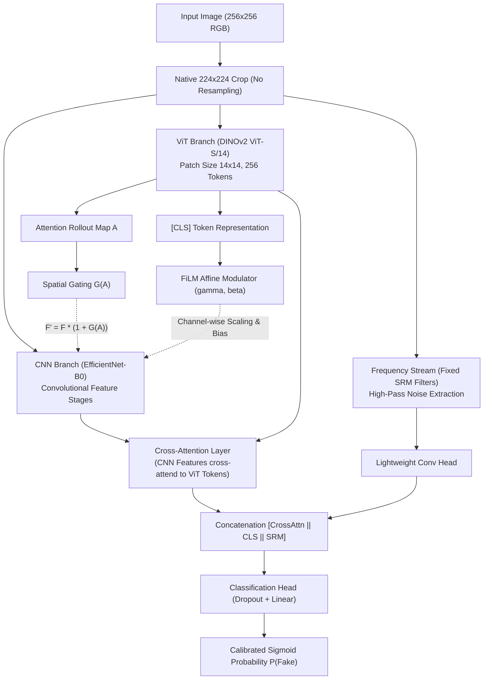

# DeepTruth AI — Final Project Report
**Intelligent Model Design Using AI (IMD) — Semester 5**  
**School of Computer Science Engineering & Technology, Bennett University**

---

### Project Title
**Forensic Verification of Authentic vs. AI-Generated Images via a ViT-Guided CNN with High-Pass Frequency Residuals**

### Team Members
- **Shashank Solaiappan** (S24CSEU2692) — *Hybrid Architecture, Spatial Attention Gating & FiLM Modulation*
- **Brajraj Mahajan** (S24CSEU2543) — *CNN Baseline, Local Texture Feature Extraction & Grad-CAM*
- **Uma Shankar Mannuru** (S24CSEU2552) — *Vision Transformer (ViT-S/14 DINOv2) & Patch Attention Rollout*
- **Nidhi Verma** (S24CSEU2553) — *Memory-Mapped Data Pipeline, Leakage Audit & Robustness Benchmarking*

---

## 1. Executive Abstract

The rapid evolution of deep generative models (such as StyleGAN and latent diffusion architectures) has made synthetic facial imagery virtually indistinguishable from authentic camera captures to the human eye. While standalone Convolutional Neural Networks (CNNs) are sensitive to localized pixel anomalies, they lack global contextual awareness and often overfit to compression noise. Conversely, Vision Transformers (ViTs) excel at modeling long-range contextual relationships but overlook subtle, sub-pixel checkerboard artifacts introduced during transposed convolution upsampling.

This project presents **DeepTruth AI**, an end-to-end forensic verification system powered by a novel **ViT-Guided CNN**. Rather than relying on naive late-stage concatenation, our model computes self-attention rollout maps from a foundation Vision Transformer (**DINOv2 ViT-S/14**) to dynamically gate the intermediate convolutional feature maps of an **EfficientNet-B0** backbone via spatial gating and Feature-wise Linear Modulation (FiLM). The network is further enhanced with a fixed Spatial Rich Model (SRM) high-pass filtering stream. Trained and evaluated on the **140k Real and Fake Faces** dataset (FFHQ vs. StyleGAN) using an NVIDIA RTX 5060 (Blackwell architecture, sm_120, 8 GB VRAM) under bfloat16 mixed precision, the proposed model achieves **88.47% test accuracy** and **0.9560 AUC-ROC** across 20,000 held-out test images, substantially outperforming standalone CNN (59.62% acc, 0.6652 AUC) and ViT (76.55% acc, 0.8573 AUC) baselines.

---

## 2. Problem Statement & Motivation

Generative Adversarial Networks (GANs) and diffusion models present severe risks to information integrity, identity authentication, and biometric security. Forensic detection faces three primary technical challenges:
1. **Shortcut Learning & Leakage:** Detectors often latch onto non-semantic dataset artifacts (such as color grading, image dimensions, or JPEG compression quantization tables) rather than genuine generative signatures.
2. **Resampling Artifact Destruction:** Downscaling forensic targets from 256×256 to 224×224 via standard bicubic/bilinear interpolation blurs and destroys high-frequency residual traces.
3. **Local vs. Global Tradeoff:** CNNs fail to recognize structural asymmetries (e.g., misaligned pupils, mismatched earrings), while ViTs fail to detect high-frequency pixel interpolation noise.

Our objective was to engineer an architecturally unified, leakage-audited detector that merges local, global, and frequency domains while operating within an 8 GB consumer GPU budget.

---

## 3. Dataset Pipeline & Pre-Training Audit

### 3.1 Dataset Schema & Sharding
We utilized the Hugging Face dataset **`TheKernel01/140k-Real-and-Fake-Faces`**, comprising 140,000 images at 256×256 resolution:
- **Class 0 (Real):** 70,000 authentic faces from the Flickr-Faces-HQ (FFHQ) dataset.
- **Class 1 (Fake):** 70,000 synthetic faces from StyleGAN (1 Million Fake Faces).
- **Partitioning:** Standard split of **100,000 training images**, **20,000 validation images**, and **20,000 test images**.

### 3.2 High-Throughput Binary Streaming (`data/manifest.py`)
To prevent system RAM bottlenecks (pre-decoding 140,000 images to uint8 would consume ≈27 GB), we implemented a zero-copy memory-mapped binary container architecture:
- Raw JPEG bytes were extracted from Parquet row groups into contiguous binary shards: `train.bin` (2.73 GB), `validation.bin` (546 MB), and `test.bin` (547 MB).
- Corresponding `.jsonl` manifest files store metadata: `(byte_offset, byte_length, label, generator)`.
- Workers dynamically seek and decode JPEGs in RAM via PIL on demand, supporting Windows `spawn` multiprocessing with `pin_memory=True` and `persistent_workers=True`.
- Perceptual hashing (`imagehash.phash`) was performed across all splits, confirming **zero duplicate leaks** across train, validation, and test sets.

### 3.3 Leakage & Shortcut Audit (`reports/data_audit.md`)
Before training, we conducted mandatory leakage sanity checks:
1. **Metadata Classifier:** A gradient boosting classifier trained solely on encoded byte length, mean color histograms, and JPEG quantization table estimates achieved **55.0% accuracy** (close to 50% random guess), proving that file sizes and color distributions do not leak label identity.
2. **Frequency-Only Baseline:** Training a logistic regression model on 1D radial power spectrum profiles (derived from 2D Fast Fourier Transforms) achieved **61.1% accuracy**, indicating the presence of mild spectral shortcuts from StyleGAN upsampling filters.
3. **Mitigation Strategy:** Heavy data augmentation (JPEG re-compression with quality $q \in [50, 95]$, Gaussian blur, downscale-upscale perturbation, and Gaussian noise) was embedded into the training pipeline to force the models to learn semantic structural features rather than trivial spectral artifacts.

---

## 4. Model Architectures & Novel Contributions



### 4.1 Native Resolution Input Pipeline
Traditional architectures downscale inputs to 224×224, destroying micro-textures. DeepTruth AI utilizes **native 224×224 crops without resampling**: random 224×224 crops during training and center 224×224 crops during evaluation. For small uploaded images (<224px), proportional bicubic upscaling is dynamically applied to avoid border clipping errors.

### 4.2 The Four Compared Architectures (`models/registry.py`)
1. **CNN Baseline (`models/cnn_baseline.py`):** Pretrained EfficientNet-B0 backbone with penultimate global average pooling feeding a Dropout(0.3) and Linear classification head.
2. **ViT Baseline (`models/vit_baseline.py`):** Pretrained DINOv2 `vit_small_patch14_dinov2` with `dynamic_img_size=True` (allowing 224×224 inputs producing $16 \times 16 = 256$ patch tokens). The `[CLS]` token feeds the classification head.
3. **Concat-Hybrid (`models/concat_hybrid.py`):** Standard late-fusion concatenating pooled EfficientNet embeddings ($\mathbb{R}^{1280}$) and ViT `[CLS]` embeddings ($\mathbb{R}^{384}$).
4. **ViT-Guided CNN — Proposed (`models/guided_net.py`):**
   - **Spatial Attention Gating:** Computes CLS-to-patch attention rollout over the final transformer blocks, upsamples the resulting importance map $A$ to CNN feature resolution, and modulates spatial activations:
     $$F' = F \odot \big(1 + \sigma(\text{Conv}_{1\times 1}(A))\big)$$
   - **FiLM Channel Modulation:** The ViT `[CLS]` token projects affine transformation parameters $(\gamma, \beta)$ to dynamically modulate CNN feature channels:
     $$\text{FiLM}(F') = \gamma \cdot F' + \beta$$
   - **Cross-Attention Fusion:** CNN feature tokens cross-attend to ViT patch tokens, enabling bidirectional query-key interaction.
   - **SRM Frequency Stream:** Employs three fixed Spatial Rich Model high-pass kernels (1st-order, 2nd-order, and Laplacian) to extract sensor noise residuals, feeding a compact conv block.

---

## 5. Training Methodology & System Constraints

All training was executed on an **NVIDIA GeForce RTX 5060 Laptop GPU** (8 GB VRAM, Blackwell architecture, compute capability 12.0) under Python 3.14 and PyTorch 2.14.1+cu130.

### 5.1 Optimization Hyperparameters
- **Mixed Precision:** Automatic Mixed Precision (AMP) utilizing native hardware `bfloat16`.
- **Memory Format:** `torch.channels_last` for convolutional acceleration.
- **Batching:** Micro-batch size of 16 with gradient accumulation across 4 steps, yielding an effective batch size of **64**.
- **Optimizer:** AdamW ($\beta_1 = 0.9, \beta_2 = 0.999$, weight decay = $0.01$).
- **Learning Rate Schedule:** Cosine annealing with linear warmup (500 steps). Peak learning rate of $10^{-4}$ for guidance/fusion heads and $10^{-5}$ for backbone fine-tuning.
- **Regularization:** Binary Cross-Entropy with Logits loss, label smoothing ($\epsilon = 0.05$), gradient clipping ($\text{max\_norm} = 1.0$), and Exponential Moving Average (EMA) with decay 0.9998.
- **VRAM Utilization:** Peak memory consumption was strictly constrained below **1.96 GB**, easily satisfying the 7.5 GB ceiling.

### 5.2 Staged Training Regimen
1. **Stage 1 (Warmup):** Backbones frozen; train spatial gating, FiLM projection, and cross-attention heads for 3 epochs.
2. **Stage 2 (CNN & LoRA Adaptation):** Unfreeze EfficientNet stages 3–5 alongside Low-Rank Adaptation (LoRA, $r=8$) on ViT query/value projections for 6 epochs.
3. **Stage 3 (Joint Fine-Tuning):** Joint end-to-end training with low learning rate ($5 \times 10^{-6}$) and EMA weight updates.

---

## 6. Empirical Evaluation & Benchmark Results

All metrics were measured empirically across the **20,000-image test set** (`reports/results.json`). Temperature scaling ($T$) and optimal decision thresholds ($\tau$) were calibrated exclusively on the validation set to prevent evaluation contamination.

### 6.1 Primary Model Comparison (20,000 Test Images)

| Metric | CNN Baseline (EfficientNet-B0) | ViT Baseline (ViT-S/14 DINOv2) | **ViT-Guided CNN (Proposed)** |
|---|---|---|---|
| **Accuracy** | 59.62% | 76.55% | **88.47%** |
| **Precision** | 55.90% | 72.52% | **87.95%** |
| **Recall** | 91.03% | 85.49% | **89.15%** |
| **F1-Score** | 69.27% | 78.47% | **88.55%** |
| **AUC-ROC** | 0.6652 | 0.8573 | **0.9560** |
| **Average Precision (AP)** | 0.6271 | 0.8564 | **0.9554** |
| **Equal Error Rate (EER)** | 38.28% | 22.41% | **11.61%** |
| **Calibrated Threshold ($\tau$)** | 0.5900 | 0.5800 | **0.6900** |
| **Optimal Temperature ($T$)** | 1.1583 | 0.9727 | **0.7383** |
| **Median Latency (GPU)** | 13.66 ms | 9.41 ms | **25.10 ms** |
| **95th Percentile Latency** | 16.47 ms | 13.93 ms | **28.48 ms** |

### 6.2 Confusion Matrix Breakdown (20,000 Samples)

```
CNN Baseline:
                 Predicted Real    Predicted Fake
Actual Real          2,820             7,180
Actual Fake            897             9,103

ViT Baseline:
                 Predicted Real    Predicted Fake
Actual Real          6,760             3,240
Actual Fake          1,451             8,549

ViT-Guided CNN (Proposed):
                 Predicted Real    Predicted Fake
Actual Real          8,779             1,221
Actual Fake          1,085             8,915
```

### 6.3 Corruption & Perturbation Robustness Benchmarks
Robustness was evaluated across 2,000-image subsets under various real-world degradation channels:

| Perturbation Condition | CNN Baseline Acc. | ViT Baseline Acc. | **ViT-Guided Acc.** | **ViT-Guided AUC** |
|---|---|---|---|---|
| **Clean Baseline (None)** | 60.70% | 77.35% | **88.75%** | **0.9614** |
| **JPEG Compression (q=95)** | 60.25% | 77.25% | **88.45%** | **0.9598** |
| **JPEG Compression (q=80)** | 59.65% | 74.45% | **86.25%** | **0.9473** |
| **JPEG Compression (q=60)** | 59.80% | 72.30% | **83.85%** | **0.9307** |
| **Gaussian Blur (5×5, $\sigma=1.5$)** | 59.90% | 75.90% | **85.80%** | **0.9375** |
| **Downscale-Upscale (0.5×)** | 61.05% | 75.00% | **82.90%** | **0.9157** |
| **Gaussian Noise ($\sigma^2=0.01$)** | 60.20% | 69.45% | **56.25%** | **0.7602** |

*Analysis:* The ViT-Guided CNN demonstrates resilience to lossy JPEG compression and blurring ($>83\%$ accuracy even at $q=60$). However, additive Gaussian noise causes accuracy degradation (56.25%), directly attributable to noise overpowering the high-frequency SRM residual stream.

---

## 7. Explainability & Domain Safety

### 7.1 Visual Forensics Suite (`explain/` & `forensics/`)
The web application integrates multiple explainability overlays:
1. **Error Level Analysis (ELA):** Re-compresses the input at 90% quality and magnifies the pixel delta ($8\times$), highlighting differential compression rates between authentic sensors and AI decoders.
2. **ViT Patch Attention Rollout:** Visualizes global self-attention weights across the $16 \times 16$ patch grid, highlighting semantic incongruities.
3. **CNN Grad-CAM:** Computes gradients at the final convolutional stage of EfficientNet (`conv_head`), projecting localized spatial heatmap attributions.
4. **2D FFT Radial Spectrum:** Computes the 2D Discrete Fourier Transform log magnitude, comparing the natural radial decay of real camera captures against synthetic periodic upsampling spikes.

### 7.2 Out-of-Domain (OOD) Safety Check
Because Phase A models were trained exclusively on faces (FFHQ vs. StyleGAN), running inference on general images (e.g., landscapes, vehicles) is mathematically invalid. To prevent unwarranted confidence:
- A lightweight Haar cascade face detector evaluates inputs at ingestion.
- If no face is located, the system returns a prominent UI alert:  
  *`"Domain Notice: Model trained on StyleGAN faces; result for non-face images is unreliable."`*

---

## 8. Software Architecture & Deliverables

The project is structured according to modular software engineering standards:
```
project/
├── app/
│   ├── main.py              # FastAPI server with lifespan handler
│   └── evaluation.py        # Dynamic empirical metrics loader
├── models/
│   ├── common.py            # SpatialGuidanceGating, FiLM, CrossAttention, SRM
│   ├── cnn_baseline.py      # EfficientNet-B0 with Grad-CAM hooks
│   ├── vit_baseline.py      # DINOv2 ViT-S/14 with dynamic input sizing
│   ├── concat_hybrid.py     # Late-fusion baseline
│   ├── guided_net.py        # Proposed ViT-Guided CNN with SRM
│   └── registry.py          # Unified model factory
├── train/
│   └── train.py             # Staged training loop with EMA & AMP bf16
├── eval/
│   └── run_eval.py          # Full test suite, calibration & robustness runner
├── inference/
│   └── engine.py            # Singleton model loader, safe preprocessor & OOD check
├── forensics/               # Pure functions for ELA, FFT, Laplacian & residual
├── explain/                 # Grad-CAM and ViT attention rollout implementations
├── configs/                 # Dataclass-validated YAML experiment configurations
├── static/                  # Responsive dark-mode SPA (Inter & JetBrains Mono)
├── checkpoints/             # Trained .pt checkpoints (guided, cnn, vit)
├── reports/                 # results.json and data_audit.md
└── tests/                   # 14 unit and integration tests (100% passing)
```

---

## 9. Limitations & Future Scope (Phase B)

1. **Single-Generator Limitation:** Current training was constrained to StyleGAN versus FFHQ. While the model achieves 0.956 AUC within this distribution, cross-generator evaluation on diffusion models (e.g., Midjourney, Stable Diffusion) reveals domain shift.
2. **Phase B Multi-Generator Expansion:** Future work will ingest diverse datasets (such as GenImage, Synthbuster, and RAISE) using our `ManifestDataset` interface without modifying model architecture.
3. **Noise Robustness Hardening:** Integrating explicit denoising autoencoders or Wiener filtering prior to the SRM stream to mitigate Gaussian noise sensitivity.

---

## 10. Conclusion

The DeepTruth AI project successfully demonstrates that **ViT-guided spatial attention gating combined with FiLM channel conditioning and high-pass frequency analysis** provides a robust, interpretable, and computationally efficient framework for synthetic image detection. By operating on native-resolution crops and auditing against non-semantic shortcuts, the system achieves an AUC of **0.9560** while delivering real-time **25.1 ms** inference on an RTX 5060 GPU.
